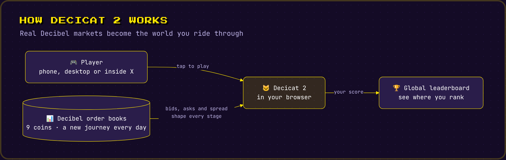
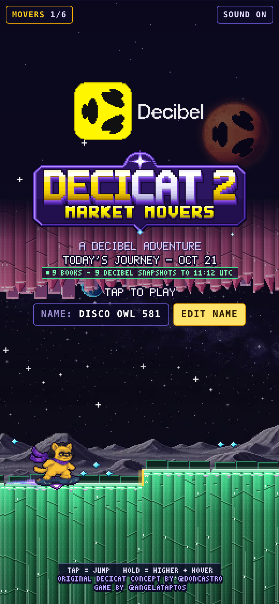
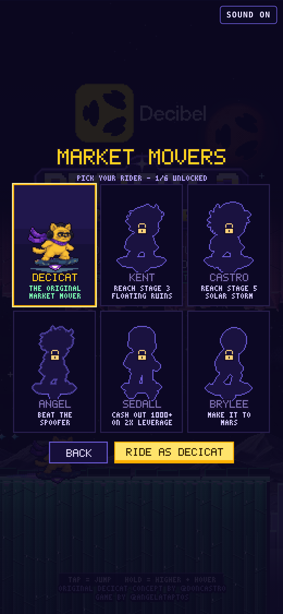
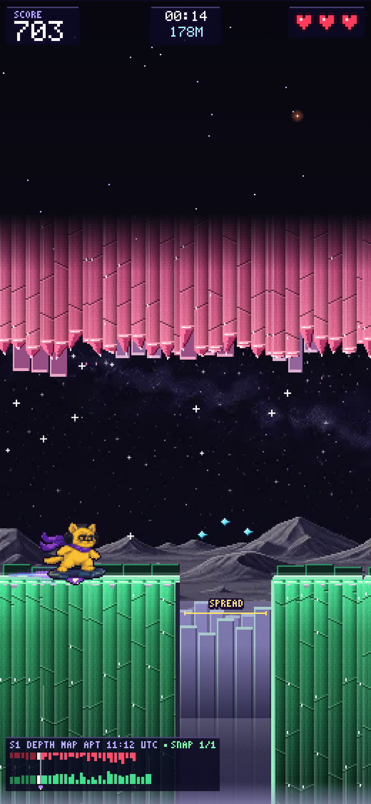
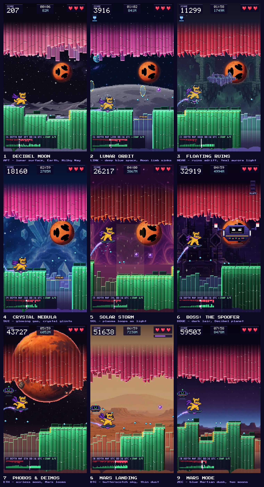
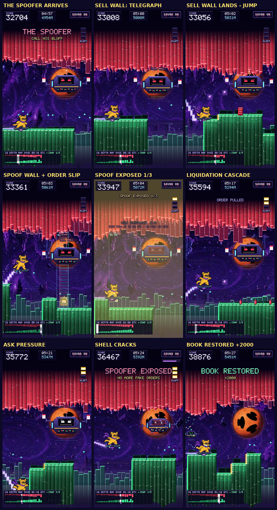
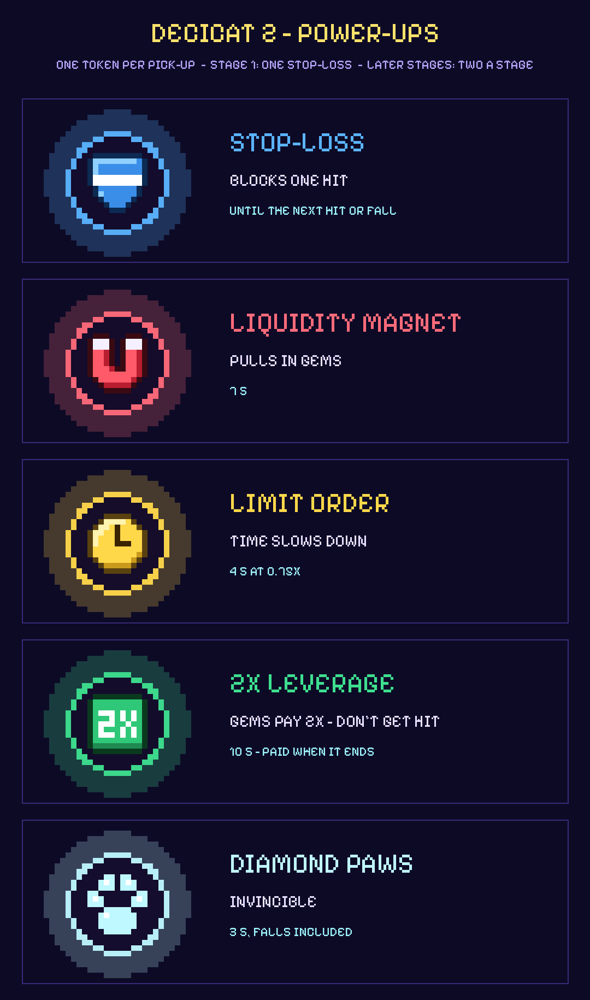
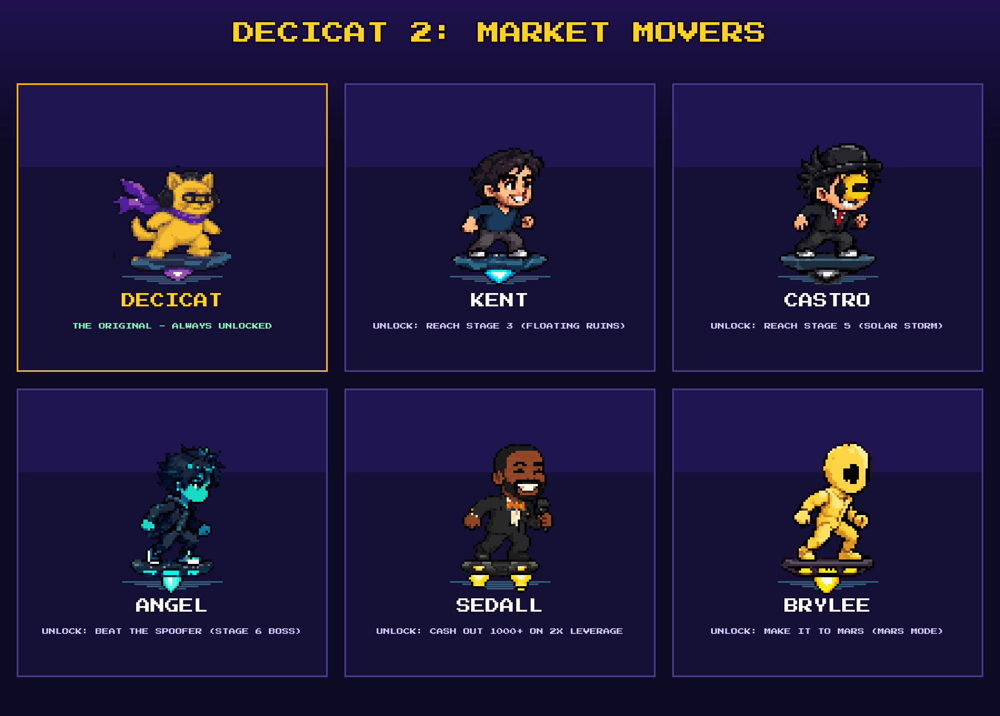

# DECICAT 2: MARKET MOVERS

**A Decibel Adventure.** Hoverboard from the Decibel Moon to Mars through a land shaped by real order books:
bids below, asks above, mind the spread.

Decicat 2 is the sequel to Decicat and part of **Bitcade**, my series of one-button browser arcade games. It plays on
phones, on desktop and right inside X, with no sign-up.

| Title | Pick your rider | On the Moon |
| --- | --- | --- |
|  |  |  |

## The story

Decicat already beat the Bear King and rode a rocket to the Moon. Now the journey continues: from the Decibel Moon,
Decicat sets off for Mars on a hoverboard, across a world built out of the markets themselves. The ground is made of
buy orders, the ceiling hangs down from sell orders, and the spread between them opens the gaps you have to jump.
Somewhere on the way a rogue market maker is faking orders to push everyone around. Call his bluff, restore the book,
and plant the flag on Mars.

## What's in it

- **9 stages, each built from a real Decibel order book of a different coin.** The deeper the bids, the taller the
  cliffs; the heavier the asks, the lower the ceiling; a wide spread means a wide gap.
- **A new journey every day.** Each stage follows its coin through the day in up to five snapshots of the market, so
  the terrain shifts as you ride, and tomorrow's run is different again.
- **Five power-ups** with trading names: STOP-LOSS, LIQUIDITY MAGNET, LIMIT ORDER, 2X LEVERAGE and DIAMOND PAWS.
- **A boss fight against The Spoofer**, a rogue market maker hiding behind fake orders.
- **Unlockable Decibel team characters**: ride as Kent, Castro, Angel, Sedall or Brylee once you earn them.
- **Mars Mode**: keep going after the landing for as long as you can last.
- **An original soundtrack**, one track per stage, plus a cinematic intro.
- **Global leaderboard** with exact ranks.

## How to play

Decicat runs on its own. Your only job is to jump.

| Input | Action |
| --- | --- |
| Tap, click, Space, Up arrow, W or Enter | Jump |
| Hold the jump | Jump higher, then hover |
| M | Mute or unmute |

Land on the green bid columns, duck under the red ask columns, jump the spread, and time the drones that patrol the
asks. You have three lives, and every portal gives one back.

## The stages

| # | Stage | Coin | Twist |
| --- | --- | --- | --- |
| 1 | Decibel Moon | APT | low gravity, floaty jumps |
| 2 | Lunar Orbit | LINK | fly through rings for an extra jump |
| 3 | Floating Ruins | NEAR | islands adrift in space, mind the spread |
| 4 | Crystal Nebula | SUI | bouncy pink crystal tops |
| 5 | Solar Storm | SOL | plasma jets lift you up |
| 6 | The Spoofer | DOGE | boss fight |
| 7 | Phobos and Deimos | ETH | Mars is close now |
| 8 | Mars Landing | BTC | Mars gravity, plant the flag |
| 9 | Mars Mode | ZEC | keep going |

## The Spoofer

The boss of stage 6 drops telegraphed sell walls, hides behind spoof walls and sets off liquidation cascades.
Grab three of his fake order slips to expose him, survive the ask pressure, and restore the book.

## Power-ups

## Market Movers

Decicat is the original market mover. Five members of the Decibel team join as unlockable riders, each earned in play.

## Soundtrack

- [Title theme](docs/music/00_title_theme.mp3)
- [Stage 1: Decibel Moon](docs/music/01_decibel_moon.mp3)
- [Stage 2: Lunar Orbit](docs/music/02_lunar_orbit.mp3)
- [Stage 3: Floating Ruins](docs/music/03_floating_ruins.mp3)
- [Stage 4: Crystal Nebula](docs/music/04_crystal_nebula.mp3)
- [Stage 5: Solar Storm](docs/music/05_solar_storm.mp3)
- [Stage 6: The Spoofer](docs/music/06_the_spoofer.mp3)
- [Stage 7: Phobos and Deimos](docs/music/07_phobos_and_deimos.mp3)
- [Stage 8: Mars Landing and Mars Mode](docs/music/08_mars_landing.mp3)

## Credits

Original Decicat concept by [@doncastro](https://x.com/doncastro)  
Game by [@angelataptos](https://x.com/angelataptos) (Angel)

## License

Copyright (c) 2026 Angel Fundora. All rights reserved. Source code is private.
See [LICENSE](LICENSE).
