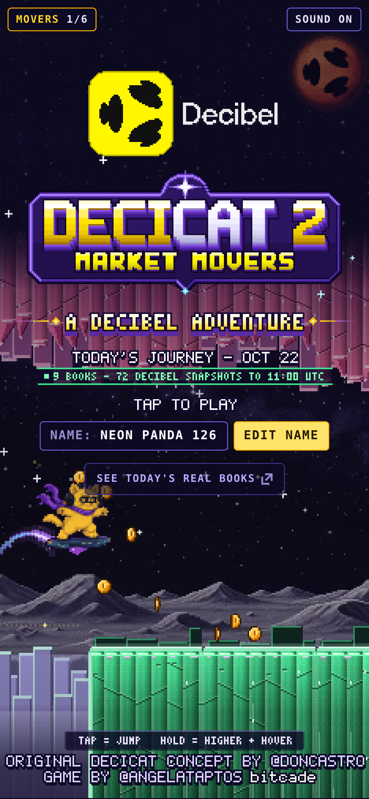
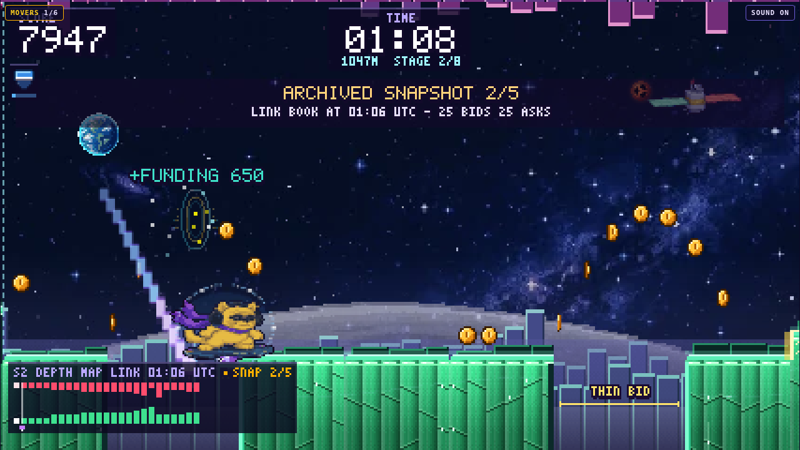
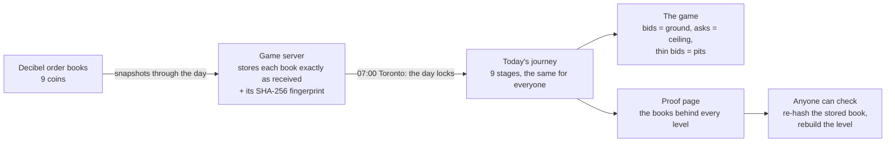
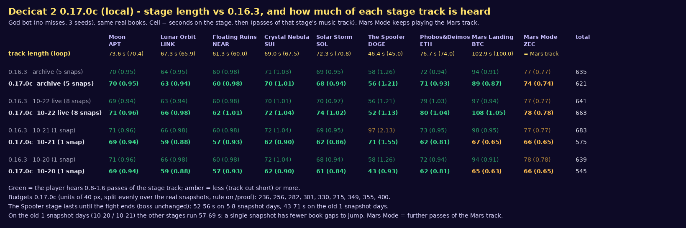
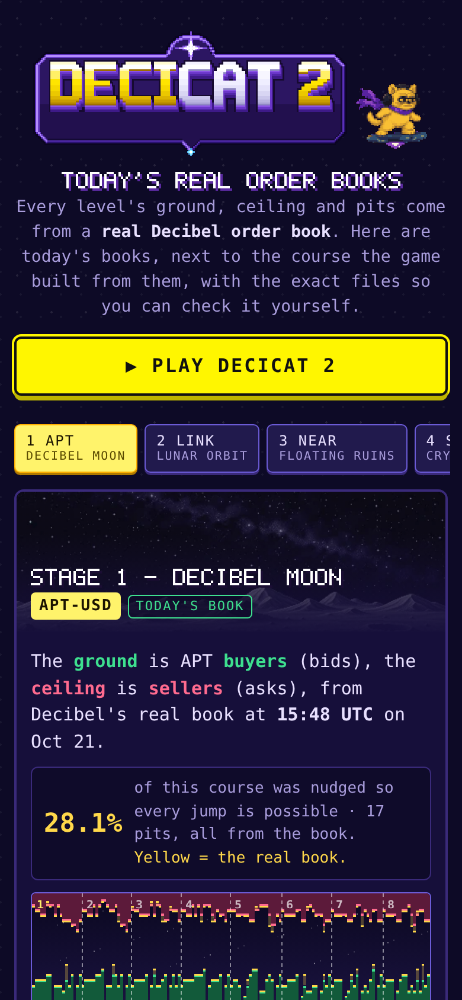
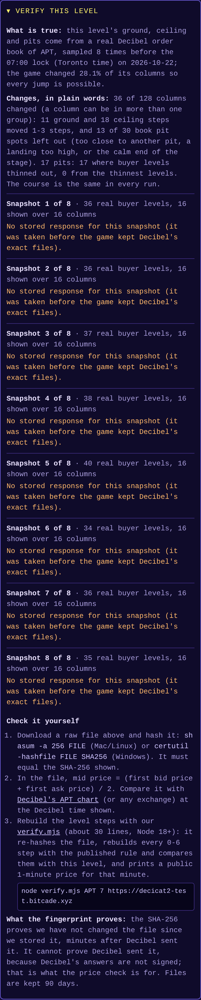
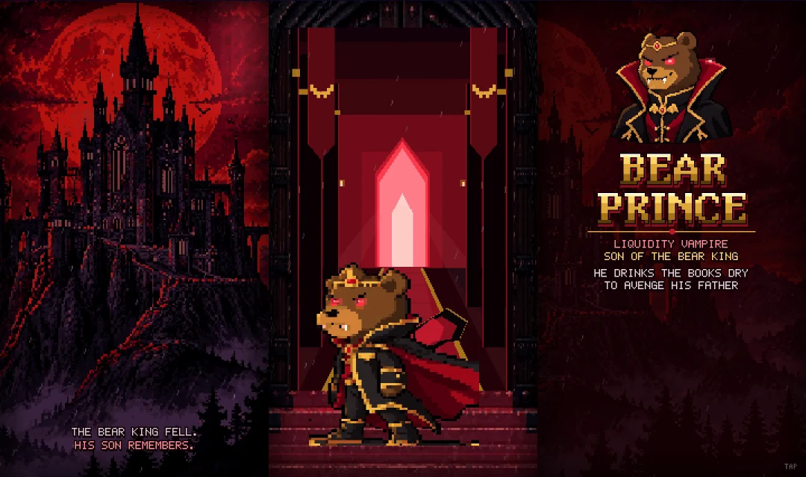
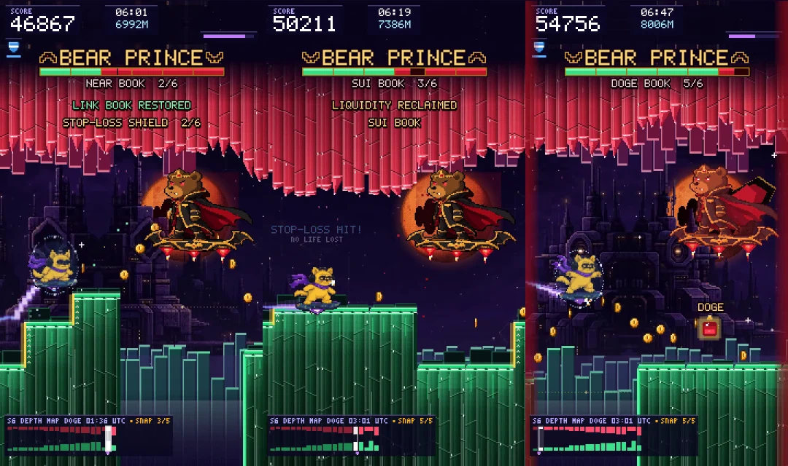
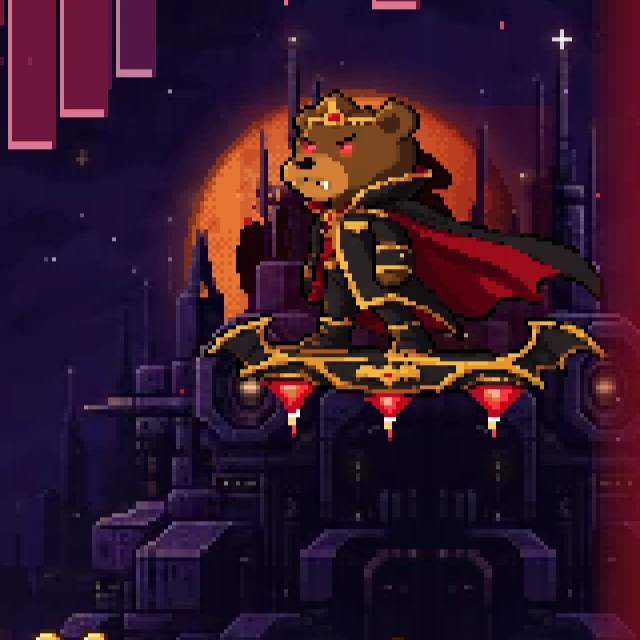

# DECICAT 2: MARKET MOVERS

**A Decibel Adventure.** Hoverboard from the Decibel Moon to Mars through a land shaped by real order books:
bids below, asks above, mind the spread.

Decicat 2 is the sequel to Decicat and part of **Bitcade**, my series of one-button browser arcade games. It plays on
phones, on desktop and right inside X, with no sign-up.

**Current version: 0.18.3** (October 2026). Recent updates: 0.18 brings a new stage-6 boss, **the Bear Prince**, with a
Castlevania-inspired intro cinematic, Decibel Mars behind his castle and his own battle music; 0.18.3 makes the Angel
rider unlock again: beat the Bear Prince to earn him. Before that, 0.15
added the public proof page, 0.16 added gold coins, the Decibel coin, sound-wave rings and the teleport between stages,
0.17.0 built the pits straight from the book and made every level independently verifiable, and 0.17.1 keeps each day's
books private until the 07:00 Toronto lock.

| Title | Pick your rider | In the book |
| --- | --- | --- |
|  |  |  |

## The story

Decicat already beat the Bear King and rode a rocket to the Moon. Now the journey continues: from the Decibel Moon,
Decicat sets off for Mars on a hoverboard, across a world built out of the markets themselves. The ground is made of
buy orders, the ceiling hangs down from sell orders, and the spread between them opens the gaps you have to jump.
But the Bear King has a son. The Bear Prince, a liquidity vampire, has crept out of his castle to drain the markets' order
books dry and avenge his father. Decicat and the crew have to stop him, win back the stolen liquidity, and plant the flag
on Mars.

## What's in it

- **9 stages, each built from a real Decibel order book of a different coin.** The deeper the bids, the taller the
  cliffs; the heavier the asks, the lower the ceiling; a wide spread means a wide gap.
- **A new journey every day.** Each stage follows its coin through the day in several snapshots of its market (up to
  eight), so the terrain shifts as you ride. The day locks at 07:00 Toronto time, and tomorrow's run is different again.
- **The gaps come from the book.** Pits open where the buy side thins out, so the same book gives every player the same
  course. There is no randomness in the terrain.
- **Pickups.** Gold coins on real jump arcs, one Decibel coin per stage, and sound rings that pay a FUNDING PAYMENT.
- **Check it yourself.** A public proof page shows the real books behind today's levels (see below).
- **Five power-ups** with trading names: STOP-LOSS, LIQUIDITY MAGNET, LIMIT ORDER, 2X LEVERAGE and DIAMOND PAWS.
- **A boss fight against the Bear Prince**, the Bear King's son: six life bars for six stolen order books, opened by a
  Castlevania-inspired cinematic and scored with his own battle theme.
- **Teleport between stages.** Each stage ends at a glowing portal that beams Decicat on to the next market.
- **Unlockable Decibel team characters**: ride as Kent, Castro, Angel, Sedall or Brylee once you earn them.
- **Mars Mode**: keep going after the landing for as long as you can last.
- **An original soundtrack**, one track per stage, a cinematic intro, and the Bear Prince's battle theme.
- **Global leaderboard** with exact ranks.

## How to play

Decicat runs on its own. Your only job is to jump.

| Input | Action |
| --- | --- |
| Tap, click, Space, Up arrow, W or Enter | Jump |
| Hold the jump | Jump higher, then hover |
| M | Mute or unmute |

Land on the green bid columns, duck under the red ask columns, jump the spread, and time the drones that patrol the
asks. You have one life, so a STOP-LOSS is worth grabbing.

## The stages

| # | Stage | Coin | Twist |
| --- | --- | --- | --- |
| 1 | Decibel Moon | APT | low gravity, floaty jumps |
| 2 | Lunar Orbit | LINK | wide steps, steady rhythm |
| 3 | Floating Ruins | NEAR | islands adrift in space, mind the spread |
| 4 | Crystal Nebula | SUI | bouncy pink crystal tops |
| 5 | Solar Storm | SOL | plasma jets lift you up |
| 6 | The Bear Prince | DOGE | boss fight |
| 7 | Phobos and Deimos | ETH | Mars is close now |
| 8 | Mars Landing | BTC | Mars gravity, plant the flag |
| 9 | Mars Mode | ZEC | keep going |

## Built from real Decibel order books

Each stage has a fixed length that is split evenly over all of its coin's snapshots for the day. Nothing is published
before the day locks at 07:00 Toronto time.

## Proof page

The proof page (`/proof`) shows, for every stage of today's journey:
- the real book behind each snapshot and the level built from it;
- how much smoothing the fairness rules applied;
- any fallback to an archived book.

Each snapshot also carries the fingerprint (SHA-256) of the exact response the game received from Decibel. A small
script from the same page lets anyone download that response, re-hash it, rebuild the level and compare.

| Proof page | Verify a level |
| --- | --- |
|  |  |

## The Bear Prince

Decicat beat the Bear King in the first game. His son remembers. The Bear Prince is a liquidity vampire: he has stolen the
order books of the first six markets of the journey, and each of his six life bars is one of them. Each bar holds two orbs
of stolen liquidity; grab the orbs he siphons and the liquidity flows back. Empty a bar and that market's book is restored,
with a STOP-LOSS shield as a reward.

His attacks grow with every bar he loses: BID SIPHON drains a strip of the floor, BAT SWARM sends a low swarm of bats,
ASK DRAIN pulls the asks down from the ceiling, CAPE SLASH throws a blade at head height, and ROYAL DIVE slams his board
down to send a shockwave along the ground. On his last bar, BLOOD MOON, he uses all of them, faster. Every attack is
telegraphed. Restore all six books to defeat him; take too long and he escapes with what is left.

The fight opens with a short Castlevania-inspired cinematic (skippable with a tap): a blood moon over his castle in the
storm, the gate, the doors, the Prince stepping out, his cape, and his leap onto the board. During the fight Decibel Mars
hangs in the sky behind his castle.

| The cinematic | The fight |
| --- | --- |
|  |  |

The Bear Prince replaced The Spoofer, the stage-6 boss from 0.9 to 0.17.

## Power-ups

## Market Movers

Decicat is the original market mover. Five members of the Decibel team join as unlockable riders, each earned in play.

## Soundtrack

- [Title theme](docs/music/00_title_theme.mp3)
- [Stage 1: Decibel Moon](docs/music/01_decibel_moon.mp3)
- [Stage 2: Lunar Orbit](docs/music/02_lunar_orbit.mp3)
- [Stage 3: Floating Ruins](docs/music/03_floating_ruins.mp3)
- [Stage 4: Crystal Nebula](docs/music/04_crystal_nebula.mp3)
- [Stage 5: Solar Storm](docs/music/05_solar_storm.mp3)
- [Stage 6 (originally The Spoofer's theme)](docs/music/06_the_spoofer.mp3)
- [Stage 6 boss: The Bear Prince, intro and battle (60 second preview)](docs/music/06b_the_bear_prince_preview.mp3)
- [Stage 7: Phobos and Deimos](docs/music/07_phobos_and_deimos.mp3)
- [Stage 8: Mars Landing and Mars Mode](docs/music/08_mars_landing.mp3)

## Credits

Original Decicat concept by [@doncastro](https://x.com/doncastro)  
Game by [@angelataptos](https://x.com/angelataptos) (Angel)  
Bear Prince battle music by Angel with Composer, inspired by Suikoden 2's Neclord battle (original composition)

## License

Copyright (c) 2026 Angel Fundora. All rights reserved. Source code is private.
See [LICENSE](LICENSE).
